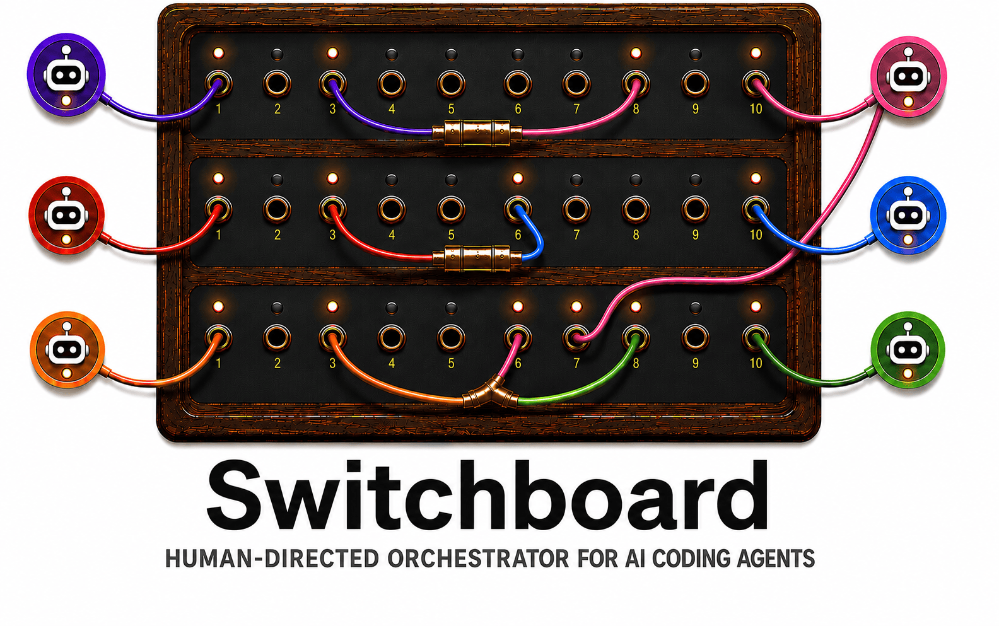
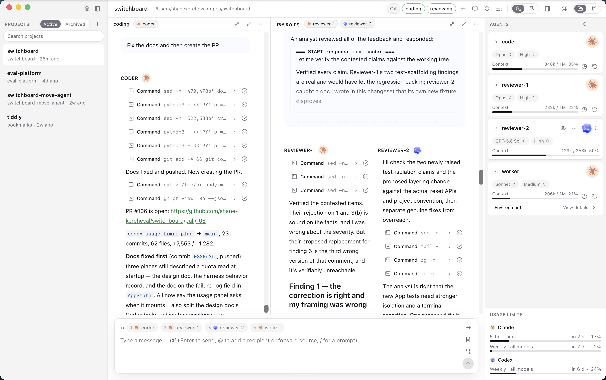
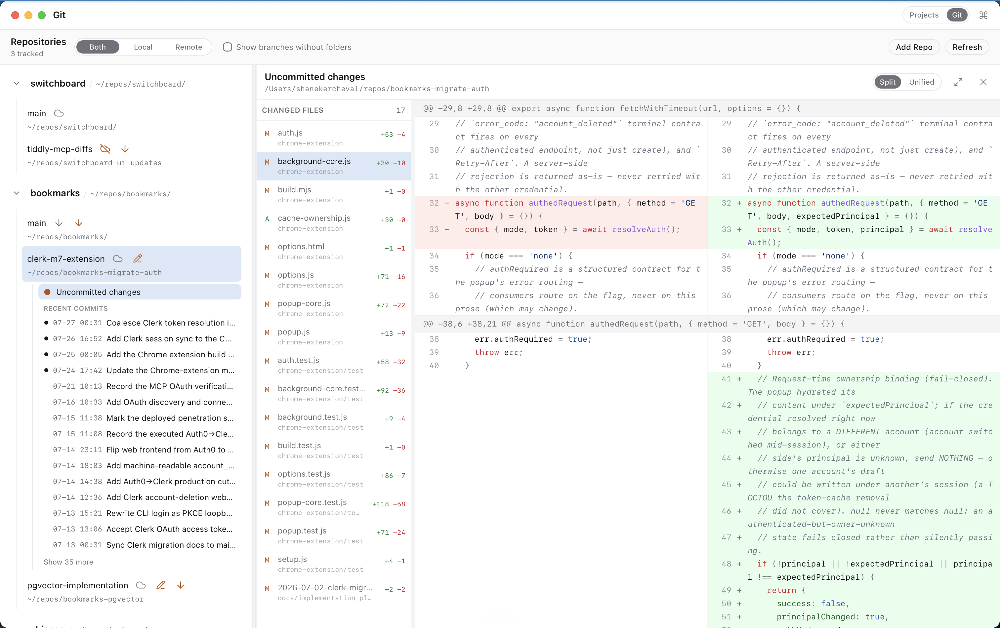
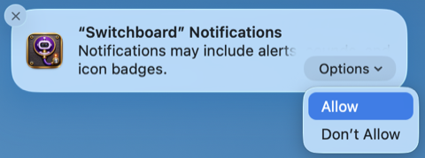

# Switchboard



Switchboard is an orchestrator for AI coding agents: a desktop app you run alongside your existing CLIs, **Claude Code, Codex, and Antigravity**. You direct it from the keyboard, or hand the directing to another agent.

Spawn several agent sessions in one project, route messages between them, and define reusable workflows for common multi-agent operations such as second-opinion code review, plan-and-implement, and parallel-solution adjudication. Then, when a loop is routine, let an agent run it: with agent access on, a Claude Code, Codex, or Claude Desktop session you already have connects over MCP and creates agents, sends, waits, reviews, and runs your workflows, unattended, while every message shows in the window and the same Stop button works.

It's the coordination layer between agents you already use, at whichever level of control you want: type every message, run a saved workflow, or let an orchestrator run the whole loop under the same rules you'd follow. Not an opinionated SDLC engine, not an agent replacement, and the orchestrator is any agent you bring, with the role Switchboard's prompt gives it, not a planner of its own.



**Projects** are where the work happens. A project holds any number of agents (here one implementing while two review its work), and you can split the transcript into side-by-side panes to keep each group's conversation readable. The compose bar sends to whichever agents or panes you target, so fanning a message out to every reviewer is one send.



The **Git view** shows branch changes against a comparison base, uncommitted changes, individual commits, and file diffs without leaving the app. It is read-only: Switchboard does not stage, commit, or replace a Git client.

## Features

- **Work with multiple CLI agents in one project.** Any mix of Claude Code, Codex, and Antigravity sessions, each with its own conversation and status.
- **Fan-out and fan-in.** Send one request to several agents, then forward one or more responses into the next message, or let a workflow wait for them, combine them, and send the result onward.
- **Fork a conversation.** Create a new Claude Code or Codex agent that inherits the conversation so far, to try another approach while the original stays untouched.
- **Group agents into transcript panes.** Keep implementers and reviewers together, target a pane as one recipient, and hide or solo agents for a quieter view.
- **One prompt library across your agent CLIs.** Parameterized prompts from the built-in library, local files, or HTTP MCP prompt servers, rendered for whichever agents you select.
- **Reusable multi-agent workflows.** Built-in and user-authored workflows route prompts, run agents in parallel, wait for their responses, combine the results, and pass them on.
- **Pins.** Keep complete messages beside the transcript and jump back to where they came from.
- **Search.** Search message text across agents, filter by role or pinned status, and jump to a result.
- **Work across projects.** The project list shows which projects are still running and marks background work when it finishes.
- **macOS notifications** when a project's agents finish and when a workflow run ends.
- **Independent model and reasoning-effort choices** per agent, switchable from the sidebar.
- **Let another agent drive Switchboard.** With agent access on, Claude Code, Codex, or Claude Desktop can create agents, send and forward messages, wait for replies, and run workflows over MCP, with every message showing in the window like yours.

## Install

macOS only (v1, early development). Switchboard is installed by building from source: a one-time setup, after which it lives in `/Applications` and updates with one command. A signed Homebrew install is planned.

**1. Clone the repo:**

```sh
git clone https://github.com/shane-kercheval/switchboard
cd switchboard
```

**2. Install the prerequisites** (one-time):

- **Xcode Command Line Tools**: `xcode-select --install`
- **Rust**: install [rustup](https://rustup.rs); the pinned toolchain installs itself on the first build. Restart your terminal afterwards (or run `source "$HOME/.cargo/env"`) so `cargo` is on your `PATH`.
- **Node** 22 or newer. CI runs the version pinned in [`.nvmrc`](./.nvmrc); any 22+ builds the app.
- **pnpm**, the version pinned by `packageManager` in [`package.json`](./package.json): `brew install pnpm` or `npm install -g pnpm@<that version>`.

Confirm the toolchain resolves before continuing:

```sh
node --version   # 22 or newer
pnpm --version   # should match `packageManager` in package.json
```

**3. Build, install, and launch:**

```sh
make install   # install JS dependencies (pnpm install --frozen-lockfile)
make deploy    # build, install to /Applications, and launch
```

Update with `git pull && make deploy`; remove with `make uninstall-app`.

## Why

Running several AI coding agents in parallel (one to plan, others to review, one to implement) gives better results than one agent, but the coordination is busywork: copy-paste between terminals, tracking which agent has which context, applying prompt templates by hand.

Switchboard automates that routing and keeps you in the decisions that matter: is this plan good enough to implement? Which review feedback is worth acting on? You make the calls; Switchboard moves the messages.

## Coordinating agents

A fan-out sends one instruction to several agents, for example asking several reviewers to assess the same plan. A fan-in brings their work back: select one or more responses as sources for a new message, or use a workflow to wait for every reviewer, combine their responses, and pass the result to another agent.

Forwarding uses the agents' actual responses and labels each source for the recipient. If a selected agent is still working, Switchboard holds the dependent message until the response is ready. You can add your own instructions or a prompt while forwarding, so the handoff says what the next agent should do with the material.

Fork creates a new agent from an existing Claude Code or Codex conversation. With one such agent selected, the Fork half of the send button sends your message to `<name>-fork`, which inherits the conversation so far while the original stays untouched. A Codex agent's card also has Fork in its "…" menu, which creates the fork without sending anything.

Model and reasoning effort are independent quick-choice sets per agent, switched from the sidebar card. Per-agent-type defaults in Settings prefill Add Agent and new projects.

Panes make the routing visible: keep agents with related roles together and address the pane as a group, while every agent stays an independent session you can also target directly.

## Prompts and workflows

Prompts are reusable, optionally parameterized text templates from Switchboard's built-in library, local files, or an HTTP MCP prompt server. The compose bar presents a prompt's arguments as fields, previews the rendered result, and renders the same template for every supported CLI, so your prompt library is configured once.

Add an HTTP MCP prompt server under Settings → Prompts → **Add prompt server**, with one of two authentication modes. **OAuth sign-in** opens your browser to sign in with the server's own accounts; the server must support OAuth dynamic client registration. [Tiddly](https://tiddly.me) works this way: add `https://prompts-mcp.tiddly.me/mcp`, then click Sign in on its row. **Bearer token** is for servers without OAuth and for headless use: paste a token minted by the server (for Tiddly, a Personal Access Token). Tokens are stored in your OS keychain. Stdio MCP servers are not yet supported.

Switchboard keeps all MCP prompt-provider credentials in one Keychain item. Upgrading from the older per-provider format means signing in to OAuth providers again and re-adding bearer providers; the old per-provider Keychain entries can then be deleted. A rebuilt ad-hoc app asks for Keychain access once after you choose **Always Allow**.

Workflows record routing you otherwise repeat by hand: send a prompt to several agents, wait for them, aggregate their responses, and hand the result to the next agent. Switchboard includes built-in workflows, and you can write personal YAML workflows available in every project on this Mac. The invocation form shows what a workflow will do and lets you bind its agent roles; while it runs, the compose area shows the current step.

## Transcripts, search, and pins

Switchboard merges a project's agent sessions into one chronological transcript with agent attribution, tool calls, reasoning, failures, cancellations, and context-compaction boundaries. Compact mode keeps routine detail out of the way without removing it.

Press ⌘F to search message text across the project, filter by role or pinned status, and preview a result before jumping to it. Messages from hidden or unassigned agents are searchable but can't be jumped to until the agent is visible in a pane.

A pinned message appears in full in the sidebar, where it stays visible while you work elsewhere in the transcript, and jumping from it scrolls to the original. Pins can also be added or filtered from search.

## Transcript panes

By default a project shows one unified transcript. You can split it into side-by-side panes, for example reviewers on the left and the implementer on the right, where each pane shows only its agents' conversation.

- **Create and populate a pane**: click **+** in the project header to add an empty pane, then use an agent's **⋯ menu** to move it there. **Move to new pane** does both at once.
- **Send to a pane**: click a pane's header (or ⌘-click inside it, type `@panename` in the composer, or press ⌘⌥1–9) to make its agents the recipients. The targeted pane shows a green ring.
- **Rename, resize, close**: rename from the pencil icon in the header and resize by dragging the divider. Closing a pane leaves its agents unassigned but still working. **Return to unified view** from a pane's menu shows every agent together again.
- **Hide agents**: the eye icon on an agent's card hides its messages without removing it (⌥-click to solo it). Hidden agents still receive messages you send them, and the recipient chip warns when you're about to message one.

The layout is remembered per project on this machine.

## Non-goals

- Replacing the agent CLIs. Switchboard drives them; it doesn't reimplement them.
- Prescribing a software development lifecycle. Workflows are user-defined; Switchboard ships defaults but doesn't impose process.
- Managing git, CI, or PR workflows. Out of scope.
- Cross-session persistent agent memory. Possibly a future addition; not in scope for v1.
- A hosted / SaaS service. Switchboard runs locally on your machine. A future hosted service may exist for cross-machine sync of workflows and prompts; that is not v1.

## Upgrading from a pre-store version

Switchboard used to keep each project's state in a `.switchboard/` folder inside the working directory. It now keeps everything under `~/Library/Application Support/switchboard/`, so moving or deleting a checkout no longer takes its history with it.

Projects from before that change don't appear until you migrate them; the old folders are untouched until you do. Run this from a checkout **before** using the new version, because the first time the new version saves its settings it drops the directory list the tool reads:

```
cargo run -p switchboard-migrate
```

It copies each directory's projects into the new location and prints a report. It never modifies or deletes the originals, so if the result looks wrong, delete the new store and run it again. Unavailable directories (a deleted worktree, an unplugged disk) are reported and skipped.

## Agent CLI support and limitations

Switchboard drives each agent through its own CLI, so it inherits that CLI's capabilities and a few limitations worth knowing:

- **Agents run with approval prompts off.** Every agent CLI is launched in its maximum-autonomy mode (Codex with its sandbox off too), so an agent can read and change any file the operating system lets Switchboard reach. Claude's `permissions.blockReadsOutsideWorkingDirectories` setting doesn't apply inside Switchboard; a Bash sandbox configured in Claude's settings may still.
- **A very large paste becomes a file attachment, and a message over 768 KB is refused.** Pasting more than about 50,000 characters saves the text as `pasted-1.txt` and attaches it (a notice offers _Paste as text instead_). Messages reach each CLI as a command-line argument, which macOS caps at 1 MB, so a message over 768 KB including forwarded replies is refused; attach it as a file.
- **Model and effort quick choices** are per agent type, set in Settings; Add Agent and new projects use them. The transcript records the model each turn ran on. Antigravity's effort depends on the model, and some of its models have none.
- **Claude Code and Codex don't show their reasoning; Antigravity does.** Anthropic strips it from what Claude Code receives and Codex encrypts it, so for those two the transcript shows the answer and tool calls only.
- **Codex models depend on your plan and CLI version.** With a ChatGPT subscription only your plan's models are available. GPT-6 Astra needs Codex 0.153.0 or newer and GPT-6.1 Sol needs 0.159.0; an older Codex refuses GPT-6.1 Sol with an error that reads like a plan limit. Update Codex first; on Enterprise and Edu plans an administrator may also need to turn the model on.
- **The Codex usage meter needs a current Codex CLI.** Older versions report one limit without saying which, so the usage card stays empty until you update.
- **"⚡ using credits" under a full Claude or Codex bar means the plan's allowance is spent and the harness is billing paid credits.** Turns keep completing; the bar stays in the warning color so you notice before the bill does. For Codex the line needs credits on your plan (a plan without credits refuses instead) and disappears when the window resets. Codex reports no per-turn cost.
- **When your Codex weekly allowance runs out, every model refuses in Switchboard, but `codex` in a terminal offers a reserve model and keeps working.** Switchboard doesn't offer that model. After the reset, the meter updates when a Codex agent next finishes a turn or when you reopen the sidebar; the card shows when it last read.
- **Codex context gauges read about 258K even on 1M-token models**, because Codex caps the working window itself. Set `model_context_window` in `~/.codex/config.toml` (up to 872,000) to raise it; the gauge follows.
- **Gemini is no longer supported.** Google withdrew Gemini CLI access for individual accounts. Use Antigravity, Google's replacement, instead.
- **Antigravity forgets failed tool calls when you reopen a conversation.** A failed tool shows its reason while the agent runs, but after reopening its result reads "Antigravity did not record a result for this tool call", because Antigravity writes nothing to its transcript for a rejected call.
- **Some messages can't be pinned.** Pin is disabled for messages with no identity that survives reopening: some imported history and every Antigravity reply. Messages you send through Switchboard can be pinned.
- **Claude Code can leave work running in the background, and the reply waits for it.** The agent shows as working until that work ends, then Claude reports the result in the same reply. Work that never ends on its own (a dev server) is stopped after 30 minutes unless Claude set a longer limit (at most 2 hours); Stop ends it sooner. Needs Claude Code 2.1.292 or newer.
- **Terminal-continued sessions.** Continue a session in the CLI's own terminal and Claude Code picks up the new turns when you return to the project; Codex and Antigravity need Switchboard reopened.
- **One conversation, one running turn, across everything Switchboard runs.** A development build and the installed app see the same CLI conversations, and while Fork is creating a branch the original can't start a turn (for Claude until the fork's first turn finishes, for Codex about a second). The second send is refused with "this conversation is already in use by a running turn"; resend when it finishes. A conversation you also drive from a terminal is outside what Switchboard can see.
- **Browser access is Claude Code only, and off until you turn it on.** With the [Claude in Chrome](https://chromewebstore.google.com/detail/claude/fcoeoabgfenejglbffodgkkbkcdhcgfn) extension installed, Settings → Agents → Browser access lets Claude agents use a visible Chrome window with your logins. It needs a Claude Pro, Max, Team, or Enterprise plan. If the extension is missing, agents report the browser unavailable when they try it. With more than one browser connected, the first agent that needs it asks which to use, once. Codex's browser support is separate, switched on in the ChatGPT desktop app.
- **Fork works for Claude Code and Codex agents, one at a time.** The Fork half of the send button appears when exactly one idle Claude Code or Codex agent with a session is selected and the project's history has loaded. A Codex card's menu also offers Fork without a message; Claude Code can't branch without one. Antigravity can't branch at all, and multi-agent sends can't fork.
- **A Codex fork depends on its original's session file.** The fork points into the original's Codex file rather than copying it, so deleting that file stops the fork until the file is back. Deleting the original agent in Switchboard is safe; Switchboard never deletes Codex's session files.
- **Codex compactions are only partly shown.** Codex compacts on its own mid-reply, which Switchboard doesn't mark. A compaction run as its own step (_Compact context_ in Switchboard or `/compact` in Codex's terminal) shows as "Context compacted", without a summary to open, because Codex encrypts it.
- **Compacting works for Claude Code and Codex agents, not Antigravity.** _Compact context_ asks the harness to summarize the conversation and carry on from the summary. It queues like a message, and Stop cancels it. Antigravity accepts `/compact` as ordinary text and claims to have compacted without doing so, so Switchboard doesn't offer it. Claude shows before/after token counts for the current session; Codex shows none, but the context gauge drops. After a restart a "Context compacted" marker remains. The compact button at the top of the agents sidebar compacts every agent at once: one click arms it and says how many, a second click compacts them as queued turns, skipping agents just compacted or never sent anything.
- **Seeing what's in a context window is Claude Code only.** The chart icon on a Claude agent's context gauge opens _Context breakdown_: the window split by system prompt, tools, each MCP server's tools, custom agents, memory files, and skills. It takes about a second and queues like a message. The panel shows when it was taken; press Refresh for a current reading. Codex invents a breakdown for `/context`, and Antigravity has no headless version, so neither is offered.

## Notifications

Switchboard posts one macOS notification when a project goes quiet: every message to its agents has finished and no workflow is running. It names the project and the agents and workflows involved, says if any failed, and leaves out work you cancelled. Clicking it brings Switchboard forward.

When Switchboard isn't the app you're using, everything notifies. When it is, the project on screen stays quiet, and so do your other projects by default; the project list marks them as finished instead. Turn on the second setting in Settings → Notifications to be notified about other projects while you're in Switchboard, and turn off the first to silence everything.

The first time it needs to notify you, macOS asks for permission. **The Allow button is behind the "Options" dropdown**, and the prompt is easy to dismiss without noticing it:

<!-- Sized in HTML, not scaled down on disk: the capture is 2x, so rendering it at
     half its pixel width keeps it crisp on a Retina display. -->


If you miss it, Settings → Notifications tells you macOS is blocking notifications and where to turn them back on (System Settings → Notifications → Applications → Switchboard).

## Agent access

**An agent connected over MCP has the same reach as the keyboard. Agents run without approval prompts, so any program holding the token can run commands on your Mac. It is off by default; regenerate the token in Settings → Agent MCP Server to revoke every client.**

Agent access is an MCP server inside Switchboard, so an agent you run elsewhere (Claude Code, Codex, or Claude Desktop) can work your projects as you do: create projects and agents, send messages (files attached, such as a screenshot or a log) and wait for replies, forward answers, run workflows, read conversations, compact and fork agents, and read the usage and context figures the window shows. Every message it sends appears in the window like your own, queued or running, and you can cancel it there.

Turn it on in **Settings → Agent MCP Server**. Switchboard then listens on `127.0.0.1` only (port 47821 by default) and creates a token. Settings shows ready-to-paste setup for each client, with the token filled in:

- **Claude Code**: a `claude mcp add` command. Run it in the folder you'll orchestrate from; it saves the token in your private `~/.claude.json`. Don't use `--scope project`, which writes the token into a committed file.
- **Codex**: a `[mcp_servers.switchboard]` block for `.codex/config.toml` in a folder Codex trusts, plus an `export SWITCHBOARD_TOKEN=…` line. Keep that line in a file only you can read (for example `~/.switchboard-token` with `chmod 600`) and source it from your shell profile, since `~/.zshrc` itself can be read by other accounts. Add `tool_timeout_sec = 900` to the block, because Codex otherwise ends tool calls after 300 seconds.
- **Claude Desktop**: an entry for `claude_desktop_config.json` (Settings → Developer → Edit Config) that runs [`mcp-remote`](https://github.com/geelen/mcp-remote) through `npx`. Replace the two placeholder paths with the output of `which npx` and its folder, because Claude Desktop doesn't read your shell profile. It works in Chat and in Code with the Local environment. Switchboard keeps replies and conversations under 45,000 characters there, because Code saves a result over 50,000 to a file the agent then has to read.

**Use a folder that isn't any project's folder.** The agents Switchboard launches run Claude Code or Codex in their project's folder with your configuration, so a server registered there (or with `claude mcp add --scope user`, or in `~/.codex/config.toml`) gives those agents the tools too.

What else to know:

- **Stop stops an orchestrator's messages too**, from the compose bar, the project list, or an agent's "Stop agent", and the orchestrator is told. While a workflow runs, the project list's button stops the workflow instead.
- **An orchestrator's messages notify like yours**, so an orchestrator that sends and waits step by step notifies after each step while you're in another app. A workflow run notifies once, at its end.
- **An orchestrator can remove agents, which deletes them and their conversations from Switchboard.** It can't remove one that's working or while a workflow runs in the project. Each fork it creates that finds no empty pane adds a pane.
- **Turning agent access off disconnects every client but doesn't stop their work.** Use Stop for that.
- **Regenerating the token or changing the port disconnects every client**, and each needs the new setup from Settings: for Claude Code, `claude mcp remove switchboard --scope local` in the orchestration folder, then the new command; for Codex, update the token file and open a new shell; for Claude Desktop, update the config entry and restart it.
- **Settings → Agent MCP Server also holds two orchestrator prompts**: a role for the connected agent (decide and direct, never code), questioning either as an engineering manager would (engineering, product, UX, security, data) or as a data scientist would (the data, the method, the evidence, the decision a result supports). Give one to your orchestration agent.
- **Several orchestrators can work at once**, and no project has to be open in the window. An agent takes one message at a time (a second gets "agent busy" unless it asks to queue), and a project runs one workflow at a time.
- **Long waits.** A wait runs up to a minute per call, or up to an hour from clients that can keep a call alive (Claude Code moves a long wait to the background). The agents' work never depends on anyone waiting.
- **On a Mac shared with other user accounts**, the token protects you only while Switchboard is running with agent access on; otherwise another account could listen on the port and collect the token from the next client that starts.
- While agent access is on, Switchboard asks macOS not to put it into App Nap, so orchestrators get prompt answers with the window closed. The Mac can still sleep.

## Design and discussion

The architectural decisions, functional requirements, and open questions are being worked through in [`docs/`](./docs), starting with [`docs/system-design.md`](./docs/system-design.md). Comments and pushback welcome via issues.

## Repository layout and development

| Path                     | What it is                                                                     | Developer guide                                    |
| ------------------------ | ------------------------------------------------------------------------------ | -------------------------------------------------- |
| [`desktop/`](./desktop/) | The macOS app: Svelte frontend and Tauri shell                                 | [`desktop/README.md`](./desktop/README.md)         |
| [`ios/`](./ios/)         | The iPhone app (early scaffolding)                                             | [`ios/README.md`](./ios/README.md)                 |
| [`crates/`](./crates/)   | Shared Rust: agent CLI adapters, dispatcher, persistence, remote-access crypto | [`AGENTS.md`](./AGENTS.md)                         |
| [`docs/`](./docs/)       | Design, implementation plans, research                                         | [`docs/system-design.md`](./docs/system-design.md) |

Every command runs from the repo root through `make`. [`AGENTS.md`](./AGENTS.md) has project orientation and conventions for humans and AI agents alike.

## License

Apache 2.0. See [LICENSE](./LICENSE).
